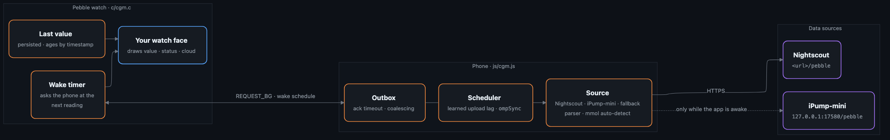

# pebble-cgm

**English** · [Deutsch](README.de.md)

Shared CGM data logic for **Pebble watch faces**: fetch glucose from **Nightscout** or the **iPump-mini** iPhone app (local, no internet), keep the last value across restarts, and stay in sync with the source – so every CGM watch face does not have to re-implement it.

Used by [CasioCGM](https://github.com/sgitaize/casiocgm), [Nightscout-supercgm](https://github.com/sgitaize/Nightscout-supercgm) and [91 Dub CGM](https://github.com/sgitaize/dubv4cgm).

**Status:** 1.1.0 · used in three watch faces in the Pebble Appstore · actively maintained

## Get it

| | |
|---|---|
| **Copy into your face** | `scripts/sync.sh <your-repo>` copies `js/cgm.js` and `c/cgm.{c,h}` into the right folders |
| **Releases** | [GitHub releases](https://github.com/sgitaize/pebble-cgm/releases/latest) · changes in [CHANGELOG.md](CHANGELOG.md) |
| **Integration guide** | [docs/integration.md](docs/integration.md) – message keys, config fields, step by step |

> Not a medical device. Watch faces built with this library show information only; treatment decisions belong to your CGM/pump and your care team.

## What it does

| | |
|---|---|
| **Nightscout** (default) | `GET <url>/pebble` (token supported). The next fetch is planned from the reading's timestamp plus a **learned upload lag**, so the watch fetches right after a new value arrives instead of polling. |
| **iPump-mini** (optional) | Reads the local Nightscout-compatible server of the [iPump-mini](https://github.com/sgitaize/iPump-mini) app on the same iPhone (`http://127.0.0.1:17580`), no internet needed. iOS only runs that app for ~25 s after each pump update; `/pebble` reports this **wake schedule** (`ompSync`) and the library fetches exactly then. |
| **Fallback** | With iPump-mini as source, Nightscout can be used as a fallback – only after a missed wake window and at most every 4.5 min (internet costs battery). Values from the fallback are flagged so the face can show a small cloud. |
| **Watch-driven wake** | PebbleKit JS timers are throttled while the phone app is in the background. The watch keeps reliable time, gets the next wake from JS and asks the phone exactly then. |
| **Last value** | Saved on the watch and shown immediately after a restart of the face (notification, other app), aging by its timestamp – no "no connection" flash. |
| **Status** | `OK`, `NO_DATA`, `NO_CONN`, `OLD`, `NO_APP` (iPump-mini unreachable for 15 min: "open the app"), `NO_URL`. |
| **Robust** | AppMessage queue with ack timeout and coalescing, search after a missed wake window, one request at a time, guard against XHRs that never call back, mmol/L auto-detection. |

## Architecture

<p align="center"></p>

<sub>Source: <a href="docs/architecture.mmd">docs/architecture.mmd</a> (Mermaid)</sub>

**How it works**
- **Two halves, one contract.** `js/cgm.js` runs in PebbleKit JS on the phone and does the networking; `c/cgm.c` runs on the watch and keeps time, state and the last value. They talk through a handful of AppMessage keys.
- **Fetch when there is something new.** The scheduler plans the next request from the reading's timestamp plus a learned upload lag (Nightscout) or from the iPump-mini wake schedule (`ompSync`).
- **The watch keeps the beat.** JS timers are throttled in the background, so the watch wakes up itself and sends `REQUEST_BG` exactly when the next reading is due.
- **Nothing gets lost.** The outbox sends one message at a time, waits for an acknowledgement (with timeout), merges outdated messages and retries.

| Part | Where | What it does |
|---|---|---|
| Phone module | `js/cgm.js` | source, fallback, scheduler, parser, outbox (needs `"enableMultiJS": true`) |
| Watch module | `c/cgm.h`, `c/cgm.c` | status codes, last-value storage, wake timer, cloud icon |
| Docs | `docs/integration.md`, `docs/ipump-mini.md` | integration step by step, the `ompSync` wake schedule |
| Sync script | `scripts/sync.sh` | copies the library into a watch face repository |
| Tests | `test/run.sh` | JS simulation and a watch timer simulation on the PC |

## Quick start

```js
// src/pkjs/index.js
var cgm = require('./cgm')({
  name: 'myface',
  settings: function () { return { source: cfg.source, nsUrl: cfg.nsUrl, nsToken: cfg.nsToken,
                                   ompUrl: cfg.ompUrl, ompFallback: cfg.ompFallback,
                                   sensorMin: 5, sync: true, manualMin: 5 }; },
  onReading: function (r) { /* format r.sgvMgdl, r.deltaMgdl, r.direction, r.tsSec, r.fallback and send */ },
  onStatus: function (code) { /* 'NO_DATA' | 'NO_CONN' | 'NO_APP' | 'NO_URL' → send status */ },
  onWakeSchedule: function (next, interval) { /* send to the watch: CGM_WAKE_NEXT, CGM_WAKE_INTERVAL */ }
});
var outbox = require('./cgm').outbox('myface');   // outbox.send(msg, label, {key: 'bg'})
Pebble.addEventListener('ready', function () { cgm.start(); });
// when the watch sends your REQUEST_BG key: cgm.fetchNow();
```

```c
// src/c/main.c
#include "cgm.h"
cgm_wake_init(request_bg_fetch);                                   // in init()
cgm_send_request(MESSAGE_KEY_REQUEST_BG);                          // in request_bg_fetch()
cgm_wake_handle_inbox(iter, MESSAGE_KEY_CGM_WAKE_NEXT, MESSAGE_KEY_CGM_WAKE_INTERVAL);  // inbox
cgm_last_save(PERSIST_KEY_CGM, &last);  /  cgm_last_load(PERSIST_KEY_CGM, &last, 6 * 3600);
cgm_draw_cloud(ctx, GPoint(x, y), color);                          // if last.fallback
```

Details: [docs/integration.md](docs/integration.md).

## Status & roadmap

- **1.1.0** (October 2026): reliability fixes – the watch no longer stops updating, a shifted iPump-mini rhythm is found again, lost requests are retried.
- Used in [CasioCGM](https://github.com/sgitaize/casiocgm), [Nightscout-supercgm](https://github.com/sgitaize/Nightscout-supercgm) and [91 Dub CGM](https://github.com/sgitaize/dubv4cgm).
- Ideas and bugs are welcome as [issues](https://github.com/sgitaize/pebble-cgm/issues).

## License

MIT – use it in your own watch faces. Credit appreciated.
